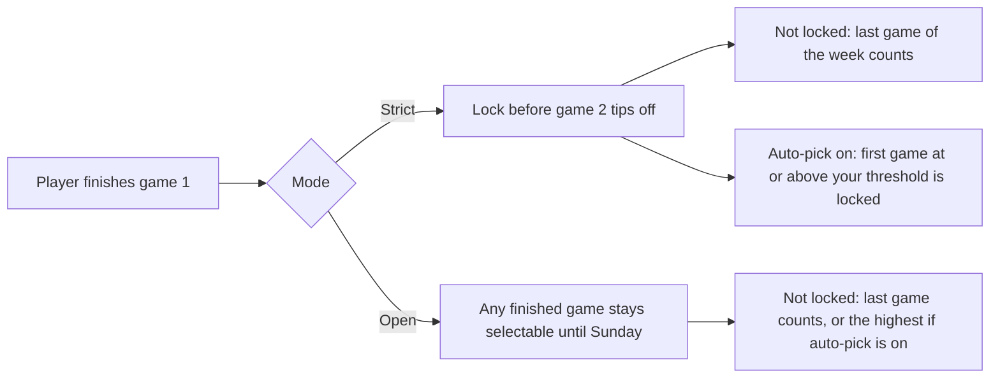
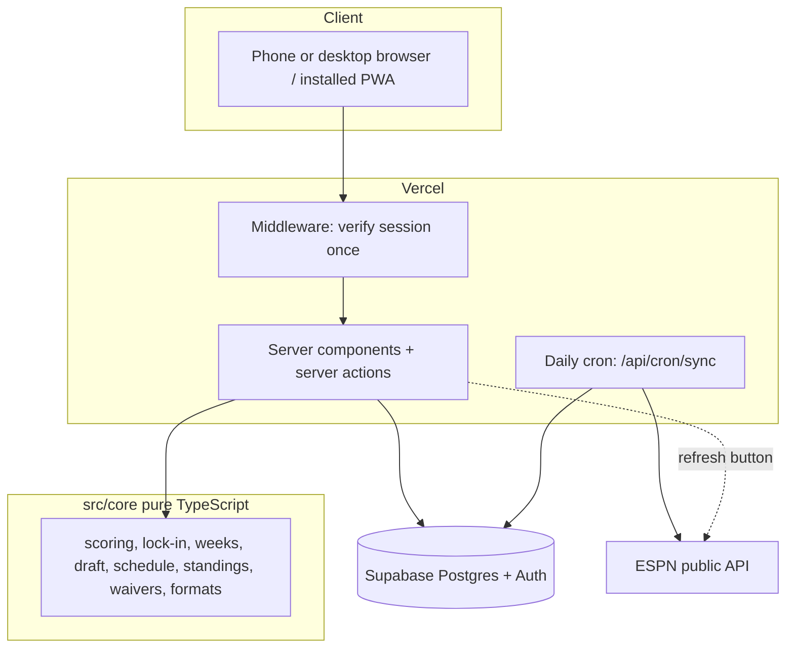

<div align="center">

# 🏀 Hoops League

**Private fantasy basketball for your friends, with Sleeper-style Lock-In scoring and a UI that isn't confusing.**

     

[Plan](fantasy_basketball_app_plan.md) · [Mockups](mockups/index.html) · [Mockup plan](mockups/MOCKUP_PLAN.md)

</div>

---

## What it is

A web app (installs to your phone's home screen like an app) for running a 3 to 12 team fantasy basketball league with friends.

| | |
|---|---|
| **Lock-In scoring** | Each player counts **one game per week**. *Strict* mode follows Sleeper's rule (lock a finished game before the player's next game starts). *Open* mode keeps every finished game selectable all week. Each manager can turn on **auto-pick**. |
| **Whole season** | Snake draft with a timer and auto-pick, lineups, add/drop, waivers (rolling priority), trades (optional commissioner approval), schedule, standings, and a playoff bracket. |
| **Free data** | Stats and headshots from ESPN's public endpoints behind a swappable adapter, refreshed daily and by a **Refresh stats** button that shows who tapped it last. |
| **Game formats** | Admins switch formats on and off at any point in the season. Betting, loans, FAAB and double-points weeks are registered and planned. |
| **Phone and desktop** | Bottom tabs on phones, sidebar and two-column pages on desktop. |

## Screenshots

> Final mockups are added here once we pick a direction. Review the options in the **[mockup gallery](mockups/index.html)** and see the **[mockup plan](mockups/MOCKUP_PLAN.md)**.

| Matchup | My team + Lock-In | Draft room |
|---|---|---|
| _coming soon_ | _coming soon_ | _coming soon_ |

## Quick start

```bash
npm install
cp .env.example .env.local        # then fill it in (see "Environment")
npm run db:migrate                # create tables on Supabase and enable row-level security
npx tsx scripts/seed-admin.mts    # creates the built-in admin account
npx tsx scripts/sync.mts 3 --players   # load players and recent games from ESPN
npx tsx scripts/seed-demo.mts     # optional: a 4-team demo league so you can play solo
npm run dev                       # http://localhost:3000
```

### Accounts

| Account | Login | Notes |
|---|---|---|
| Built-in admin | username `admin`, password `password` | **Change it on `/account` before sharing the site.** |
| Owner | any email in `ADMIN_EMAILS` | Becomes admin automatically on login |
| Everyone else | email and password, set at sign-up | No reset flow by design: "Reach out to Tejvir" |

> Turn off **Confirm email** in Supabase (Authentication → Providers → Email) so sign-up works instantly.

### Environment

| Variable | Where | Purpose |
|---|---|---|
| `POSTGRES_URL` | **Vercel + local** | Pooled database connection used by the app |
| `NEXT_PUBLIC_SUPABASE_URL` | **Vercel + local** | Supabase project URL |
| `NEXT_PUBLIC_SUPABASE_ANON_KEY` | **Vercel + local** | Public key for sign-in |
| `CRON_SECRET` | **Vercel + local** | Protects `/api/cron/sync` |
| `ADMIN_EMAILS` | **Vercel + local** | Comma-separated emails that are always admins |
| `POSTGRES_URL_NON_POOLING` | local only | Migrations |
| `SUPABASE_SERVICE_ROLE_KEY` | local only | Seed and test scripts. Never ship to the browser |

`.env.local` labels which lines go to Vercel.

## How Lock-In works



## Architecture



Pages read only from our database; the provider is only called by the sync. Business rules live in `src/core` with no framework imports, so a future React Native app can reuse them.

## Project layout

```
src/
  core/        pure rules + tests (scoring, lock-in, weeks, draft, schedule, standings, waivers, formats)
  providers/   data adapter (ESPN)
  server/      database services (sync, engine, draft, roster, waivers, trades, admin, settle)
  db/          Drizzle schema and client
  app/         pages, server actions, API routes, PWA manifest and icons
  components/  shared UI
scripts/       sync, backfill, seed-admin, seed-demo, simulate, smoke, screenshots
mockups/       design gallery (3 directions x 14 screens), plan, generator
drizzle/       SQL migrations
```

## Commands

| Command | Does |
|---|---|
| `npm run dev` / `build` / `start` | Run the app |
| `npm test` | 51 unit tests |
| `npm run typecheck` · `npx eslint src` | Types and lint |
| `npx tsx scripts/simulate.mts` | Plays a full 4-team season on real data and checks every rule |
| `npx tsx scripts/smoke.mts` | Signs in with throwaway users and loads every page (needs the app running) |
| `npx tsx scripts/screenshots.mts mockups/current` | Screenshots of the real app, phone and desktop |
| `npx tsx mockups/build.mts` · `shoot.mts` | Rebuild and render the mockups |
| `npx tsx scripts/seed-demo.mts --remove` | Delete the demo league and bot accounts |

## Install on a phone

No App Store needed. On iPhone: open the site in **Safari → Share → Add to Home Screen**. The in-app `/install` page walks through iPhone, Android, and desktop. Updates arrive automatically after each deploy. The full mobile plan (push notifications, offline, optional native app via TestFlight) is in [the plan](fantasy_basketball_app_plan.md#14-iphone-and-mobile-app-plan).

## Deploy

1. Push to GitHub; Vercel builds it.
2. Add the five Vercel variables above.
3. In Supabase, add your Vercel URL and `/auth/callback` to the redirect URLs.
4. Change the admin password on `/account`.

`vercel.json` pins functions to `us-east-1` (next to the database) and schedules the daily sync.

## Roadmap

- [x] Scoring engine, both Lock-In modes, auto-pick
- [x] Draft, waivers, trades, schedule, playoffs
- [x] Admin and game-format switches
- [x] Responsive layout, installable PWA
- [ ] Pick a design direction and apply it ([mockups](mockups/index.html))
- [ ] Push notifications and offline mode
- [ ] Betting and parlays (play money), loser lends a player
- [ ] Commissioner stat-override screen
- [ ] Native iOS app via TestFlight (only if needed)

## Data and terms

Stats and headshots come from ESPN's unofficial public endpoints. That is fine for a private friends league; it is not licensed for a public or paid product. The data adapter makes switching providers a small change.
